# Backend editorial de Manual SAMUR

La edición, detección de fuentes y publicación se ejecutan en Cloudflare. El
[diseño](cloudflare-editorial-design.md) explica las decisiones y los límites.
GitHub Actions conserva las pruebas y el despliegue de código; las entregas
editoriales no requieren PR ni un workflow de GitHub.

## Acceso

**Administración**, en el pie de la web, abre `/admin` y conduce a
`/gestion-editorial` después de iniciar sesión con GitHub. El Worker solo admite
cuentas con un correo verificado que coincida con la persona propietaria o con
una cuenta editorial activa en D1. La sesión caduca a las ocho horas y los
permisos se comprueban en cada petición.

`EDITOR_EMAIL` es la identidad propietaria, siempre administradora. Las demás
cuentas se autorizan en D1 (`editors`) como **Administración** o **Edición**.
No hay registro público ni contraseña compartida. Administración gestiona usuarios,
auditoría y controles de fuentes. El editor conserva las revisiones con autoría,
notas y referencias privadas. Cerrar sesión invalida la sesión en D1.

Si faltan las credenciales de GitHub, la entrada informa de configuración pendiente
y las APIs editoriales permanecen cerradas. El despliegue del Worker no acredita
que el acceso de la persona propietaria se haya verificado.

Configuración segura: [credentials.md](credentials.md).

## Flujo de trabajo

```mermaid
flowchart LR
  S[Control manual o cron mensual] --> J[Workflows por particiones]
  J --> P[Propuestas de fuente en D1]
  P --> E[Comparar, editar y revisar]
  E --> R[Revisiones listas congeladas]
  R --> C[Workflows: compilar y verificar]
  C --> A[Artefactos y adjuntos inmutables]
  A --> V[Puntero público transaccional]
  V --> U[Web, móvil y Watch]
```



**Comprobaciones** permite revisar todo el manual o indicar procedimientos
concretos, consultar resultados, cancelar y reintentar fuentes fallidas. El cron
mensual conserva el día 1 a las 04:00 UTC. Las comprobaciones continúan con la
página cerrada y nunca publican automáticamente.

La extracción usa las fuentes XWiki/HTML oficiales y conversión de texto PDF de
Cloudflare. Se conservan parsers y guardas de identidad y volumen. Un PDF ambiguo,
un origen incompleto o una tabla no reconocida requieren revisión manual. El
informe diferencia resultados verificados y pendientes; el texto PDF recuperado
puede consultarse de forma privada en los detalles. Una ausencia en el inventario
no archiva por sí sola una ficha.

Los candidatos no sobrescriben el cuerpo revisado, notas ni título editorial.
En **Contenidos** se comparan y resuelven, se editan con Tiptap WYSIWYG y se pasan
por borrador → en revisión → listo para publicar. El Markdown con MDX o sintaxis
especial conserva su edición de texto para evitar conversiones destructivas.
**Anuncios de novedades** ofrece formularios y edición visual del detalle; conserva
revisiones y se publica con la misma entrega.

**Publicaciones** congela las revisiones elegidas y prepara snapshot, 22 conjuntos
base, manifiesto, índices de relaciones, Markdown/LLM, historial y PDF. Una lista de
colaboradores aprobada incorpora además el conjunto `colaboradores`. Los artefactos
se derivan del contenido congelado, nunca de notas privadas o borradores vivos.
La activación comprueba el padre y estado vigente en una transacción D1. Se verifica
el puntero confirmado, no un supuesto recuento de filas modificadas por triggers.
Cancelar impide una activación tardía; restaurar prepara una nueva entrega desde
revisiones y adjuntos históricos. No se recompila Next ni se despliega el Worker
para publicar contenido.

## Trabajo por particiones

`backend/src/workflow.ts` coordina instancias cortas enlazadas con identificadores
deterministas: controles de cuatro tareas, compilación de doce documentos,
relaciones de veinte fichas y conjuntos de datos individuales. La división también
limita las llamadas acumuladas por instancia; persistir pasos dentro de una única
instancia larga no evitó ese límite en la primera prueba remota.

D1 conserva trabajos, generación de cancelación, tareas, inventario, reservas de
almacenamiento y fragmentos. Los reintentos conservan candidatos y resultados ya
verificados. Los errores no incluyen credenciales ni notas privadas. Un trabajo
interrumpido debe consultarse en la interfaz; no equivale a un control sin cambios.

## Imágenes y PDF

Los assets estáticos e históricos anteriores se conservan al desplegar código.
Los nuevos archivos se retienen en `CONTENT_ASSETS` (KV) por SHA-256 y se sirven
bajo `/docs/_cloud/<hash>/<nombre>`, con MIME verificado, `nosniff`, ETag y soporte
Range. Solo los archivos referenciados por una entrega publicada son públicos;
una sesión editorial verificada puede consultar los borradores.

KV es eventualmente consistente. El publicador espera propagación antes de activar;
una región que todavía no vea los bytes responde 503 reintentable. El cliente no
sustituye una copia verificada por otra identidad. No se usa la caché como única
copia ni se elimina material referenciado para liberar espacio.

Presupuestos de aplicación: 750 MiB de KV, 800 escrituras diarias y 25 MiB por
archivo. Las cuotas gratuitas son compartidas con otros usos de la cuenta y pueden
agotarse antes. No se habilitan R2, Containers ni un plan de pago. La conversión se
limita a texto PDF; no se describen imágenes con modelos generativos.

## Desarrollo y despliegue

```bash
npm ci
npm ci --prefix apps/mobile --ignore-scripts
npm run build
npm run backend:migrate
npm run backend:types
npm run backend:dev
```

Aplicar migraciones antes de arrancar el nuevo Worker. La configuración sin
`--env production` usa recursos locales. El entorno remoto de staging se retiró.
Para probar el cron local:
`npx wrangler dev --test-scheduled` y `http://localhost:8787/__scheduled`.
El binding AI es remoto: usar fixtures para pruebas de extracción locales.

Antes de migrar producción, exportar D1 a una ruta privada excluida de Git. El export
incluye notas y borradores. La restauración de código no revierte por sí sola D1.

```bash
npx wrangler d1 migrations apply DB --remote --env production
npm run backend:dry-run
npm run backend:deploy
```

El paso de preparación de assets conserva los adjuntos estáticos históricos y deja
los archivos Cloudflare-native en KV. El CLI de importación/publicación antiguo
queda para mantenimiento y bootstrap; el flujo de uso normal es el editor y sus
Workflows. Los secretos de GitHub para desplegar código siguen siendo necesarios
para `deploy.yml`; `PUBLICATION_GITHUB_TOKEN` deja de ser necesario.

Verificación: `npm test`, `npm run lint`, `npm run backend:typecheck`,
`npm run build`, `npm run backend:dry-run`, `npm run backend:startup` y navegador.
Las mediciones locales no sustituyen la validación de CPU/cuotas, propagación KV,
contrato móvil descargado y autenticación real en Cloudflare Free.

La evidencia de despliegue se registra en [deployment.md](deployment.md).
La API pública mantiene [su contrato](public-api.md).
