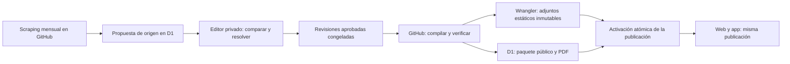

# Backend editorial de Manual SAMUR

## Decisiones acordadas

D1 es la fuente editorial. Una única identidad autenticada con Cloudflare Access
prepara, revisa y publica. La ruta `/gestion-editorial` no aparece en la navegación,
el lanzador de Access ni los buscadores. La autenticación se valida también dentro
del Worker; ocultar la ruta no constituye un control de acceso.

Estados: borrador → en revisión → listo → publicado; archivo y restauración crean
nuevas revisiones. No hay cuentas de lectores, registro ni roles. Las notas privadas
y el historial completo solo salen por las APIs autenticadas. Las publicaciones
contienen una proyección pública independiente, nunca filas editoriales completas.

## Publicación



El frontend se compila al desplegar código. Publicar contenido después ejecuta
`publish-content.yml`, sin reconstruir Next. Ese proceso compila las revisiones
congeladas fuera del Worker, verifica el contrato móvil y los hashes, conserva los
adjuntos históricos y genera el changelog en texto y PDF. Finalmente una operación
D1 cambia el puntero público; los triggers rechazan paquetes incompletos o procesos
basados en una publicación anterior. Los cambios hechos mientras se prepara una
publicación permanecen como borradores y no entran accidentalmente en ella.

El editor puede cancelar una preparación atascada. Un trabajo cancelado que termine
más tarde no puede activar su publicación. Restaurar una publicación anterior crea
otra publicación verificable; no borra el historial.

Los paquetes JSON y PDF se almacenan divididos en filas D1. Cada sentencia de
importación está por debajo de 100 KB. Los documentos y cada fuente están limitados
a 450 KB para dejar margen al límite de fila de D1. Los archivos binarios se sirven
mediante un segundo Worker de assets; sus rutas incluyen SHA-256. Un adjunto que ya
no existe en origen y nunca tuvo bytes verificables sigue señalado como no disponible,
sin inventar una copia offline. Los cambios en adjuntos verificables deben conservar
los hashes aprobados: un archivo distinto en el checkout no puede sustituirlos.

## Desarrollo local

Requiere Node 22.13+ y las dependencias raíz y móvil instaladas.

```bash
npm ci
npm ci --prefix apps/mobile --ignore-scripts
npm run build
npm run backend:types
npm run backend:migrate
npm run backend:seed
npm run backend:publish
npm run backend:dev
```

`seed` solo acepta una base vacía. Las propuestas posteriores se importan con
`npm run backend:propose`; no modifican el contenido revisado ni la publicación activa.
No se incorpora un acceso de desarrollo que pueda saltarse Cloudflare Access.
Las pruebas usan claves y bases SQLite sintéticas.

## Primer despliegue por CLI

Los permisos y la entrada segura de credenciales están detallados en
[credentials.md](credentials.md).

1. Renovar OAuth con `npx wrangler login`. La cuenta debe continuar en Workers Free.
2. Crear la base con `npx wrangler d1 create manualsamur-production` y guardar el
   `database_id` devuelto en `wrangler.jsonc`, binding `env.production.DB`.
   Para staging, repetir con el recurso y entorno staging: las bases están separadas.
3. Ejecutar:

   ```bash
   npx wrangler d1 migrations apply DB --remote --env production
   npm run backend:seed -- --remote --env production
   npm run backend:publish -- --remote --env production
   npm run backend:types
   npm run backend:dry-run
   npm run backend:deploy
   ```

   La primera publicación despliega el Worker de archivos antes del principal.
   No se puede ejecutar `seed` otra vez sobre datos editoriales existentes.
4. Configurar Access con un token cargado de forma segura en el entorno que tenga
   `Access: Apps and Policies Write`, además de los permisos de Workers necesarios
   para guardar secretos. No introducir valores de credenciales en argumentos.
   Debe existir una organización Zero Trust Free. Cargar también
   `CLOUDFLARE_ACCOUNT_ID`, `EDITOR_EMAIL` (el correo único acordado),
   `ACCESS_TEAM_DOMAIN` y `PUBLICATION_ORIGIN` (el origen HTTPS real del Worker).
   Ejecutar `npm run backend:access -- production`. El script configura las rutas
   editorial y API bajo la misma aplicación/audiencia y guarda los tres secretos
   con Wrangler. No cambia aplicaciones de Access ajenas. Este paso requiere
   verificación real del proveedor; no se ha simulado una autenticación de producción.
5. Guardar el secreto `PUBLICATION_GITHUB_TOKEN` con
   `npx wrangler secret put PUBLICATION_GITHUB_TOKEN --env production`.
   Usar un token limitado a Actions write en este repositorio para despachar el
   workflow. Las escrituras de código no necesitan estar permitidas.
6. Configurar en GitHub los secretos `CLOUDFLARE_API_TOKEN` y
   `CLOUDFLARE_ACCOUNT_ID`, y la variable `PUBLICATION_ORIGIN`. El token de CI
   necesita D1 write y Workers Scripts write para el Worker de archivos; no necesita
   acceso a otros servicios. Sin estas credenciales los procesos remotos quedan
   pendientes; la UI conserva los cambios y explica que no puede publicar.
7. Comprobar la salud, el contrato móvil, una descarga de adjunto, el PDF público,
   la denegación de acceso anónimo y el acceso de la identidad autorizada.
8. Las nuevas builds móviles ya usan el origen Cloudflare de producción registrado
   en `apps/mobile/app.json`. `EXPO_PUBLIC_MANUAL_CONTENT_ORIGIN` permite probar otro
   entorno. No existe puente con la URL antigua de Vercel.

Las configuraciones remotas, Access y los jobs GitHub deben probarse con las
credenciales reales antes de considerar el sistema desplegado.

## Límites gratuitos y recuperación

Workers Free: 100.000 peticiones al día y 10 ms de CPU por invocación. D1 Free:
500 MB por base, 5 millones de filas leídas y 100.000 escritas al día. No se activa
R2, Workers AI ni un plan de pago. Alcanzar una cuota puede impedir operaciones;
el cliente conserva su última versión verificada. El historial consume espacio:
exportar y revisar el almacenamiento antes de aproximarse al límite de la base.
El publicador se detiene si los adjuntos acumulados superan 19.000 archivos,
400 MB o 25 MiB por archivo. No borra versiones para liberar espacio automáticamente.

Antes de una operación de mantenimiento:

```bash
npx wrangler d1 export DB --remote --env production --output /ruta/privada/manualsamur-backup.sql
```

El export incluye borradores y notas privadas: guardarlo fuera de Git y de artefactos
públicos. La restauración editorial o de publicaciones no requiere borrar la base.
Una reversión de código con Wrangler no revierte automáticamente el estado D1.

## Incidencias y verificación

- #27: backend/editor/publicación descritos arriba.
- #110: APTA en pie y Acerca de, con enlace existente y aviso de adaptación no oficial.
- #111: versión oficial del pie separada de fecha de edición y revisión XWiki.
- #112: el [fallo de octubre](https://github.com/miguelrzazo/ManualSAMUR/actions/runs/36851391902/job/110333621597)
  se debía a nueve adjuntos 404. Se corrigen referencias válidas entre páginas,
  se conservan copias previas y se informan referencias inaccesibles. Algunas
  referencias ya están mal formadas en origen; no se afirma que todas descarguen.
  La importación se prepara en staging de archivos y conserva diagnósticos al fallar.
  El flujo mensual crea propuestas D1; sustituye la generación de PR de contenido.
- #29: [diseño del grafo](graph-design.md), sin nueva interfaz de grafo en esta entrega.

Comprobaciones: `npm run lint`, `npm test`, `npm run mobile:content:validate`,
`npm run mobile:typecheck`, `npm run backend:typecheck`, `npm run build`,
`npm run validate:content-parity`, `npm run backend:dry-run`,
`npm run backend:startup`, más navegador contra el Worker local.

Fuentes: [Wrangler](https://developers.cloudflare.com/workers/wrangler/),
[límites D1](https://developers.cloudflare.com/d1/platform/limits/),
[precios Workers](https://developers.cloudflare.com/workers/platform/pricing/),
[Access API](https://developers.cloudflare.com/api/resources/zero_trust/subresources/access/subresources/applications/).
