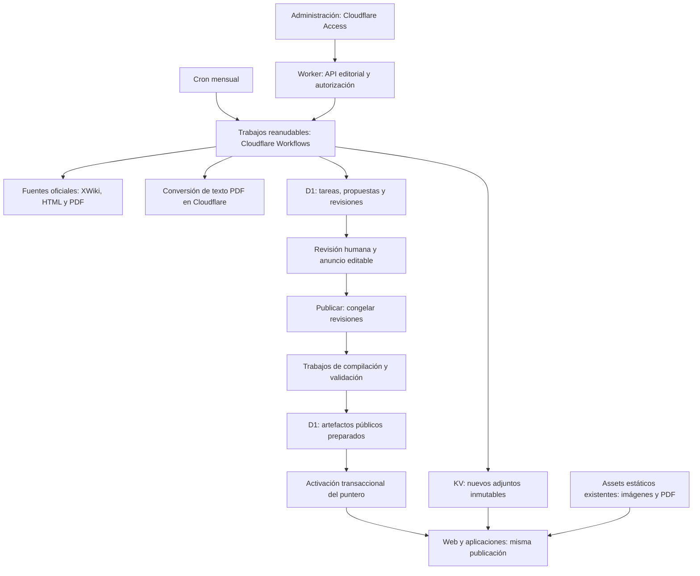

# Administración y actualización de contenido en Cloudflare Free

Fecha: 1 de noviembre de 2026.

Este documento conserva el diseño inicial. Se eligió GitHub OAuth en lugar de
Cloudflare Access y el entorno remoto de staging se retiró tras las pruebas.
Consulta la [operación actual](README.md) y la [configuración de acceso](credentials.md).

## Objetivo y decisiones

Administrar el manual, sus novedades y las actualizaciones de las fuentes desde
`/gestion-editorial`. La detección y la publicación de contenido se ejecutarán en
Cloudflare, sin GitHub Actions, PR de contenido, servidores externos ni servicios
de pago. La integración y el despliegue de cambios de código pueden seguir usando
GitHub Actions.

Decisiones confirmadas:

- Acceso inicial para la persona propietaria; incorporación posterior de personas
  editoras mediante cuentas individuales. Sin registro público ni contraseña común.
- Autenticación por correo con Cloudflare Access y autorización en el Worker.
- Enlace **Administración** en el pie de la web.
- Edición de contenidos, correcciones manuales y anuncios e historial de novedades.
- Comprobaciones manuales y mensuales. Toda publicación requiere revisión explícita.
- Se conservan imágenes y PDF, su visualización, descarga y uso offline verificable.
- Solo recursos gratuitos. No se habilitan Containers, Workers Paid, R2 ni modelos
  generativos de pago. Agotar una cuota produce una pausa o error visible.

## Punto de partida

Ya existen el editor, roles `admin` y `editor`, usuarios, auditoría, revisiones,
comparación de fuentes, resolución de propuestas y restauración de publicaciones.
D1 contiene la fuente editorial y un puntero a la publicación pública activa.

`update-content.yml` ejecuta actualmente scripts Node y `pdftotext`, valida un
candidato e importa propuestas a D1. Ya no genera PR de contenido.
`publish-content.yml` compila revisiones congeladas, conserva adjuntos y activa la
publicación. El Worker inicia ese workflow con `PUBLICATION_GITHUB_TOKEN`.

El frontend es una exportación estática de Next. Sus clientes consumen los datos
públicos del backend; publicar contenido no debe requerir reconstruir Next ni
desplegar el Worker. Los scripts actuales dependen de disco, procesos y compilación
del corpus completo, por lo que necesitan refactorización para este diseño.

## Experiencia de administración

El enlace del pie conduce al acceso protegido del editor. Una identidad sin sesión
pasa por Cloudflare Access; una identidad autenticada sin permiso recibe una
denegación clara. El cierre de sesión usa el mecanismo de Access. La ruta continúa
excluida de los buscadores. Tanto la página como las APIs se protegen también en el
origen, incluido cualquier dominio alternativo del Worker.

Se mantienen **Contenidos**, **Publicaciones**, **Usuarios** y **Registro de
cambios**, y se incorpora **Comprobaciones**:

- **Comprobar ahora** revisa todos los dominios por defecto; permite seleccionar
  dominio y procedimientos concretos.
- Muestra último control completo, próxima comprobación mensual, estado actual,
  elementos procesados, cambios detectados, advertencias y errores por fuente.
- Permite consultar ejecuciones anteriores, cancelar y reintentar tareas fallidas.
- Cada propuesta enlaza con su comparación en el editor. Un control parcial nunca
  se presenta como una comprobación completa sin cambios.
- Una configuración o binding ausente se muestra como pendiente de configurar.
  Nunca se simula un control satisfactorio.

La programación conserva inicialmente el día 1 a las 04:00 UTC del workflow actual;
la interfaz presenta fecha, hora y zona de forma explícita. El control continúa en
segundo plano al cerrar la página.

Las personas editoras pueden preparar y revisar contenido y solicitar publicaciones,
como en el editor actual. Solo administración inicia, cancela o reintenta controles
y gestiona usuarios. Las comprobaciones mensuales se atribuyen a **Sistema**.

## Arquitectura propuesta

Workflows se usa para coordinar pasos persistentes, esperas y reintentos. D1 es la
fuente de verdad de las ejecuciones, tareas y resultados que muestra la interfaz;
no se depende de la retención temporal del proveedor para el historial editorial.

El diseño divide el trabajo por fuente, documento, adjunto y fragmento de artefacto.
No ejecuta el scraper Node ni la compilación completa dentro de una petición HTTP.
Cada partición debe caber en los límites gratuitos, incluidos CPU, subpeticiones,
tamaño de estado y pasos diarios. Un bucle de pasos no garantiza por sí solo que
la ejecución cumpla estos límites: se debe medir con el corpus real.

La primera fase de implementación es una prueba de viabilidad. Si alguna operación
indivisible supera el presupuesto, se divide o sustituye y se vuelve a medir. Si
no resulta viable, se documenta el bloqueo antes de retirar el flujo existente;
no se cambia silenciosamente de plan ni se declara terminada la migración.

## Detección e importación

Se mantienen los dominios actuales: procedimientos, vademécum, códigos y contenido
principal, incluidas abreviaturas, colaboradores y enlaces pertinentes.

1. Crear la ejecución con alcance, desencadenante, autor y versión del extractor.
2. Descubrir fuentes mediante las APIs y páginas oficiales existentes.
3. Guardar un inventario de descubrimiento y validar su integridad antes de
   interpretar una ausencia como retirada.
4. Recuperar y transformar cada elemento con límites de tamaño, tiempo y dominios.
5. Conservar y verificar los adjuntos nuevos antes de ofrecerlos como disponibles.
6. Comparar la fuente normalizada con el último origen aceptado y con las propuestas
   pendientes; crear únicamente propuestas nuevas o modificadas.
7. Completar el informe, distinguiendo fuentes revisadas, fallidas y omitidas.

Se conservan las reglas actuales de idempotencia y protección de ediciones humanas.
Un origen nuevo no sobrescribe `data_json`, las notas privadas ni la publicación
activa. Un error de descarga, un control selectivo o un descubrimiento incompleto
no autorizan bajas. Las retiradas amplias conservan la protección actual de
investigación manual. Los identificadores estables, fuentes y relaciones deben
mantenerse al cambiar títulos o rutas de origen.

Las peticiones tienen tiempos máximos, reintentos limitados y espera entre accesos
al origen. Se valida cada destino de redirección. El backend no es un proxy de URLs
arbitrarias proporcionadas por el navegador.

## PDF y datos extraídos

El archivo original se conserva independientemente de su extracción. Descargar o
visualizar un PDF no exige convertirlo ni generar una descripción con IA.

Para sustituir `pdftotext`, se evaluará `AI.toMarkdown` exclusivamente en su ruta de
conversión de texto PDF. Cloudflare documenta extracción de texto y estructura del
PDF; esta ruta se distingue de los modelos usados para describir imágenes. No se
envían imágenes a modelos ni se usa texto generado para completar datos clínicos.

La salida debe probarse contra los PDF oficiales existentes, especialmente tablas
de perfusiones, fluidos, nombres comerciales, unidades y dosis. Cambiar de extractor
puede alterar orden de lectura o disposición: los parsers no se consideran
compatibles sin pruebas. Una tabla ambigua, un PDF escaneado sin texto o un archivo
no soportado queda como **Requiere revisión manual**, conservando los datos previos.
La persona editora puede consultar el original y corregir el candidato.

No se marca como actualizado el conjunto estructurado si solo se detectó o conservó
una nueva versión de su PDF. El informe diferencia ambas operaciones.

## Imágenes y adjuntos: almacenamiento y entrega

Los aproximadamente 66 MB ocupados en disco por `public/docs` y
`public/images/procedures` siguen disponibles como assets estáticos. Esta medida
local es orientativa; no representa uso actual de KV ni una auditoría remota.
No es necesario migrar todo ese material para habilitar nuevas actualizaciones.

Los archivos nuevos se guardan en un namespace KV, con identidad basada en SHA-256
de sus bytes. El metadato editorial conserva hash, tamaño, tipo, nombre y URL de
origen. Un cambio de bytes crea una identidad y ruta distintas; nunca sustituye el
archivo de una publicación o borrador anterior.

- Una tabla de D1 mantiene el inventario, tamaño reservado, estado de verificación
  y referencias desde documentos y publicaciones.
- El Worker sirve imágenes y PDF por una ruta estable del mismo origen, validando
  tipo MIME y cabeceras. Las vistas PDF admiten lectura por rangos cuando el cliente
  lo requiera; descargas y apps siguen verificando tamaño y hash.
- Los adjuntos de propuestas se consultan con autorización editorial. La entrega
  anónima exige una referencia en una publicación aprobada; conocer el hash no
  concede acceso a material de un borrador.
- KV tiene consistencia eventual. Una lectura de confirmación no demuestra
  disponibilidad inmediata en todas las regiones. Se contempla propagación antes
  de activar y respuestas reintentables si un archivo aún no está visible; no se
  devuelve otro archivo bajo el hash aprobado. Los clientes conservan su última
  copia verificable cuando una descarga falla.
- No se usa Cache API como única copia duradera ni se depende de que el origen siga
  sirviendo los mismos bytes. Nunca se atribuye disponibilidad offline a un archivo
  que no pudo conservarse y verificarse.
- No hay eliminación automática de archivos históricos para liberar cuota. Se
  requiere un procedimiento separado de exportación y retención que respete
  publicaciones antiguas y paquetes instalados.

Presupuestos iniciales de la aplicación: 750 MiB en KV, 800 escrituras KV al día y
25 MiB como techo por archivo, sujeto a un límite operativo menor si las pruebas
de memoria o CPU lo requieren. Los límites gratuitos documentados son 1 GB,
1.000 escrituras diarias y 25 MiB por valor. Son cuotas compartidas de cuenta:
los contadores de la aplicación no garantizan disponibilidad frente a otros usos.

Las reservas concurrentes se coordinan en D1. Un límite alcanzado detiene nuevas
ingestas y explica la causa; no borra datos ni activa facturación. Las copias
estáticas existentes siguen sirviéndose desde sus rutas históricas.

## Publicación y anuncios de novedades

La edición conserva el flujo borrador → en revisión → listo para publicar. El
resumen de entrega y el conjunto de novedades son editables antes de publicar;
editar un anuncio ya publicado prepara una nueva revisión y entrega. Las
publicaciones históricas siguen siendo inmutables.

Al pulsar **Publicar**:

1. Validar permisos, documentos listos y ausencia de otra publicación en preparación.
2. Congelar las revisiones públicas, el anuncio y la publicación padre en D1.
3. Compilar por particiones a partir de esas revisiones, sin leer borradores vivos,
   disco local, checkout Git ni contenido privado.
4. Preparar snapshot móvil, conjuntos públicos, manifiesto, índices de relaciones,
   búsqueda, historial paginado, Markdown/LLM y PDF del registro de cambios.
5. Verificar contratos, identidades, hashes de bytes exactos, relaciones y adjuntos.
6. Activar mediante la operación transaccional del puntero público existente,
   condicionada a la publicación padre y a que el trabajo siga vigente.

La compilación se extrae a módulos puros compartidos con los contratos existentes.
Las operaciones grandes, incluida serialización canónica y cálculo de hashes, se
procesan en fragmentos con estado persistente cuando sea necesario. Los hashes
deben coincidir con los clientes actuales; no se introduce un formato de paquete
distinto para evitar un límite de CPU.

Las rutas públicas y los 22 conjuntos del manifiesto mantienen su contrato. Se
comprueba que nuevos procedimientos y slugs funcionen con el shell estático y que
la web, apps y Watch consuman la misma identidad de publicación. No se reconstruye
Next ni se despliegan assets durante una entrega editorial.

Cancelar invalida la ejecución; un resultado tardío no puede activarla. Un fallo
deja intacto el puntero anterior. Restaurar crea una nueva entrega verificada desde
las revisiones históricas y sus adjuntos originales.

## Persistencia y contrato de ejecución

Nuevas entidades propuestas, además de las tablas editoriales actuales:

| Entidad | Responsabilidad |
| --- | --- |
| `content_jobs` | Tipo, alcance, autor, estado, progreso, fechas, generación y error público seguro. |
| `content_job_tasks` | Partición, cursor, intento, lease, resultado, error y próxima ejecución. |
| `source_inventory` | Fuentes descubiertas y evidencia de un control completo. |
| `content_assets` | Hash, tamaño, clave KV, tipo y estado de retención/verificación. |
| `content_asset_refs` | Referencias editoriales y públicas que autorizan acceso y retención. |
| `content_usage` | Reservas y consumo atribuible a la aplicación por periodo. |

Estados de trabajo: `queued`, `running`, `paused`, `completed`,
`completed_with_warnings`, `failed`, `cancelled`. Un estado con advertencias incluye
el alcance que quedó sin verificar. Los errores se resumen por tarea y no exponen
credenciales, notas privadas ni respuestas completas del proveedor.

Las tareas son idempotentes. La clave incluye trabajo, partición y generación;
los leases caducan y permiten recuperación. Cada escritura de resultado valida
que el trabajo y su generación siguen vigentes. Los reintentos no duplican
propuestas, novedades, reservas ni artefactos.

API editorial propuesta, bajo la autenticación y protección CSRF actuales:

| Ruta | Operación |
| --- | --- |
| `GET /api/editor/checks` | Estado de programación y lista paginada de controles. |
| `POST /api/editor/checks` | Crear control completo o selectivo, solo administración. |
| `GET /api/editor/checks/:id` | Progreso e informe paginado por tarea. |
| `POST /api/editor/checks/:id/retry` | Reintentar tareas recuperables, solo administración. |
| `POST /api/editor/checks/:id/cancel` | Cancelar sin modificar propuestas ya conservadas. |
| `POST /api/editor/releases` | Congelar y encolar compilación Cloudflare; reemplaza el dispatch GitHub. |

Se conservan las APIs actuales de documentos, usuarios, auditoría, restauración y
consulta de publicaciones. El navegador consulta progreso; no ejecuta el scraper,
no compila la publicación ni recibe credenciales de infraestructura.

## Cuotas, fallos y operación

Antes de fijar el tamaño de particiones se medirán CPU real, memoria, llamadas,
escrituras y tamaño del estado. Se reservará margen para las peticiones públicas.
Los límites del proveedor se vuelven a consultar al implementar y desplegar;
los valores de documentación son una referencia, no una prueba de capacidad.

Workflows Free documenta 3.000 pasos diarios, 1 GB de estado y límites heredados
de Workers. No se persistirán cuerpos completos del corpus en resultados de pasos.
D1 conserva fragmentos y referencias. Se particionan ejecuciones antes de alcanzar
los topes por instancia. El historial de control tiene retención propia y acotada,
sin borrar revisiones editoriales o adjuntos referenciados.

La interfaz distingue pausa por cuota, fallo de origen, extracción no soportada,
conflicto editorial y falta de configuración. La reanudación automática se usa solo
cuando sea segura; una intervención necesaria queda explícita. Un límite que
interrumpa un Worker antes de registrar el error se recupera por lease expirado.

La retirada de una cuenta sigue denegando nuevas peticiones inmediatamente en D1.
Los permisos de Access y la configuración de correo deben verificarse en el
proveedor. Añadir una cuenta a D1 no implica que la política de Access ya la admita.

## Implementación y transición

1. **Viabilidad:** probar extracción HTML y PDF, retención/entrega KV y compilación
   de un release real con medición de CPU y cuotas gratuitas. Resolver cualquier
   operación que dependa de Node, disco o procesos. Registrar resultados.
2. **Acceso y estado:** enlace del pie, experiencia de entrada/salida, migraciones,
   modelo de trabajos, permisos, auditoría y pantalla de comprobaciones.
3. **Ingesta:** fuentes y adjuntos, comparación, propuestas, controles selectivos,
   informes, cancelación y recuperación. Ejecutar en staging contra fixtures y
   después contra fuentes oficiales sin publicar cambios automáticamente.
4. **Publicador:** congelación, compilación por particiones, artefactos, verificación,
   anuncios editables, activación y restauración. Comparar con el compilador actual.
5. **Cambio de flujo:** verificar en staging y producción, habilitar cron Cloudflare
   y retirar `update-content.yml`, `publish-content.yml` y el dispatch GitHub.
   No dejar dos programaciones mensuales activas. Retirar el secreto
   `PUBLICATION_GITHUB_TOKEN` cuando ya no tenga consumidores.
6. **Documentación:** actualizar README, credenciales, arquitectura y operación.
   Adaptar el despliegue de código para que no requiera el antiguo proceso de
   publicación ni descarte adjuntos retenidos o compatibilidad histórica.

Hasta completar el cambio, la documentación existente describe el flujo actual.
No se deshabilita el flujo vigente antes de contar con una sustitución verificada.

## Criterios de aceptación

- Acceso real de la persona propietaria; denegación anónima, de identidades no
  autorizadas y de acciones administrativas solicitadas por personas editoras.
- Comprobación manual y mensual ejecutadas por Cloudflare con la página cerrada.
- Corpus y fuentes actuales cubiertos; errores y revisiones manuales visibles.
  Pruebas de idempotencia, ediciones concurrentes, bajas y descubrimiento incompleto.
- Imágenes y PDF existentes y nuevos se visualizan y descargan, conservan sus bytes
  históricos y no exponen adjuntos privados; verificar móviles y solicitudes Range.
- Publicación completa sin GitHub: paridad de datasets, snapshot, hashes, PDF,
  historial, búsqueda, relaciones y rutas nuevas, incluyendo los clientes nativos.
- Fallos, cancelación, ejecución tardía y agotamiento de cuota no activan una entrega
  parcial ni pisan la publicación anterior. Restauración funcional y verificable.
- Medición en Cloudflare Free con el corpus real; pruebas locales no bastan para
  acreditar CPU, propagación KV, cuotas o autenticación remota.
- Ningún recurso de pago habilitado ni dependencia operativa de PR o workflow de
  contenido. CI y despliegue de código siguen siendo independientes.

## Referencias

Documentación consultada el 1 de noviembre de 2026:

- [Límites Workers](https://developers.cloudflare.com/workers/platform/limits/).
- [Límites Workflows](https://developers.cloudflare.com/workflows/reference/limits/)
  y [precios](https://developers.cloudflare.com/workflows/reference/pricing/).
- [Límites KV](https://developers.cloudflare.com/kv/platform/limits/).
- [Límites D1](https://developers.cloudflare.com/d1/platform/limits/).
- [Conversión Markdown y precios](https://developers.cloudflare.com/workers-ai/features/markdown-conversion/)
  y [extracción de PDF](https://developers.cloudflare.com/workers-ai/features/markdown-conversion/how-it-works/).
- [Backend actual](README.md), [API pública](public-api.md) y
  [publicación coherente](../adr/0001-coherent-content-publication-and-history.md).
